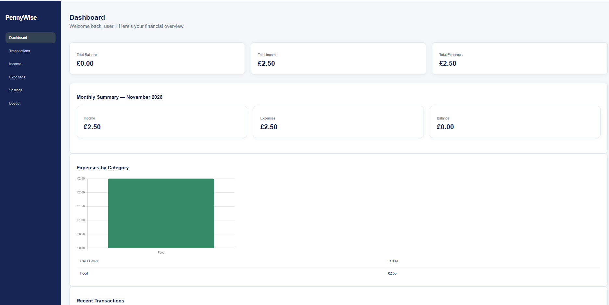
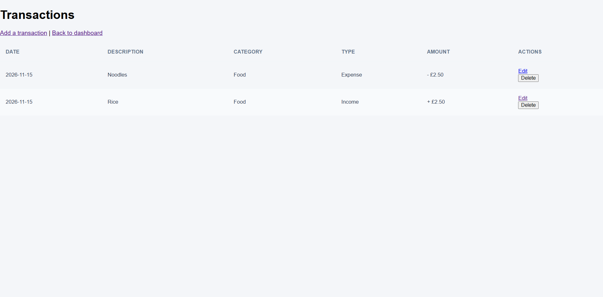

# PennyWise — Personal Finance Tracker

PennyWise is a personal finance web app built with Python and Flask. Users can record income and expenses, review their transactions, and see summaries of their finances.

## Project status

In development. The app currently runs locally and has not been deployed.

## Features

- Register, log in, and log out
- Add, view, edit, and delete income and expense transactions
- Keep each user’s transactions private to their account
- View total income, expenses, and balance
- View a monthly summary
- View expenses by category, including a chart
- Validate transaction details

## Technology

- Python and Flask
- SQLite
- HTML and CSS
- JavaScript and Chart.js

## Getting started

### Requirements

- Python 3
- Git

### Install and run on Windows

Clone the repository, replacing the example URL with your GitHub repository URL:

```powershell
git clone https://github.com/USERNAME/REPOSITORY.git
cd pennywise-finance-tracker
python -m venv .venv
.\.venv\Scripts\Activate.ps1
pip install -r requirements.txt
```

Set a random Flask session key once in PowerShell:

```powershell
$pennywiseSecretKey = python -c "import secrets; print(secrets.token_hex(32))"
[Environment]::SetEnvironmentVariable("SECRET_KEY", $pennywiseSecretKey, "User")
$env:SECRET_KEY = $pennywiseSecretKey
```

Then start the app:

```powershell
python app.py
```

Open `http://127.0.0.1:5000` in your browser. The app uses SQLite for local data storage.

## Testing

The app has been manually checked for registration and login, transaction management, account separation, dashboard totals, monthly summaries, and the expense category chart. An automated test suite has not been added yet.

## Future improvements

- Filter transactions by date
- Export transactions to CSV
- Add monthly budgets
- Add automated tests
- Prepare the app for deployment

## Screenshots

### Dashboard


### Transactions
